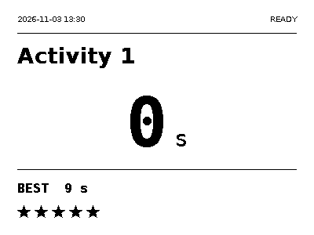

# EverydayTimer

Custom, fully offline timer firmware for **ZECTRIX NOTE4C DevKit**, ESP32-S3 N16R8, 400×300 four-color SSD2683 panel. **Not for monochrome NOTE4.** This is a custom development build, not a manufacturer-supported release.

## What it does

- Select an activity with UP or DOWN while stopped. Selection wraps and shows 0 s alongside the saved best.
- Press the front button to start or stop. The LED blinks during a run, and the screen shows READY, RUNNING, or STOPPED.
- Earn a five-point star for a first or strictly faster personal best. Daily stars reset at 23:59 local time.
- After five minutes idle, the timer gives way to a full-screen smile. Waking uses two fast refresh passes to clear its outline from the white timer screen.
- Time is displayed in whole seconds and stored in milliseconds. The timer uses a monotonic clock and keeps a separate wall clock for records.
- Configure activity names in English or common Chinese characters, sync the clock, and export history over USB. The timer runs offline.



## E-paper refresh

Boot establishes a native full-panel baseline. While running, the firmware requests a fast snapshot every second. Fast updates use a volatile monochrome waveform and a window computed from changed pixels. The panel periodically uses its slower native waveform to clear accumulated ghosting. Timing and button handling run independently of the panel refresh.

## Start here on a Mac

1. Read [safe flashing and full backup](docs/FLASHING.md). Confirm the physical model and board revision before any write.
2. Build the images into `dist/` as described in [Build and test](#build-and-test), then use `tools/flash_mac.sh`. It makes and verifies a unique 16 MiB flash backup before writing. Initial `--install` replaces existing firmware and clears the new timer storage area; `--update` preserves this timer's storage layout.
3. Read [USB management](docs/USB.md), list the port, then run `time-sync`. The PCF8563 RTC is set from your Mac in UTC; the Mac’s current offset is saved separately for the local display. Starting is blocked until this timer has successfully saved its first UTC sync (even if previous firmware left a plausible RTC calendar), and thereafter whenever the RTC is invalid, so completed runs are not assigned fake timestamps.
4. Edit `data/actions.json`, upload it, and use the buttons. Export `history.json` regularly.

Example after the virtual environment from the flashing guide is active:

```sh
python tools/note4c.py ports
python tools/note4c.py --port /dev/cu.usbmodemXXXX time-sync
python tools/note4c.py --port /dev/cu.usbmodemXXXX actions put data/actions.json
python tools/note4c.py --port /dev/cu.usbmodemXXXX history --output history.json
```

USB is a serial management interface. The device does **not** appear as a Finder drive. This avoids exposing a live internal filesystem to simultaneous writes from the Mac and device.

## Data and recovery

Keep action IDs stable when renaming or rearranging activities. A new ID deliberately starts a new record category. Removing an action does not erase its historical records; adding the same ID later restores its best. Reusing an old ID for a different activity would mix records and should be avoided.

`history.json` is an ordinary JSON object containing `schema_version` and a `records` array. A completed record looks like:

```json
{"seq":1,"action_id":"activity-1","action_name":"Activity 1","started_at":"2026-11-03T05:00:00Z","ended_at":"2026-11-03T05:00:32Z","duration_ms":32700,"status":"completed"}
```

Start and stop are journaled through a separate internal `pending.json` using LittleFS copy-on-write and checked flushes. After a reset, an unfinished attempt becomes `interrupted` with null duration/end time and is excluded from best records. A completed pending record is recovered without duplicate insertion. A truncated final append is repaired on boot; detected corruption is otherwise preserved and blocks new attempts. A filesystem that will not mount is **never automatically reformatted**, except a completely erased (all-FF) timer storage partition on initial installation. This reduces power-loss risk but is not a promise against all flash failure. Back up important history.

The history cap is 8 MiB within a 13 MiB storage partition. It will stop accepting new runs instead of deleting old ones when full. Export/archive and deliberately reinstall only after backing up if you eventually need a clean history; the USB manager requires explicit confirmation to clear history. Power interruption before the first journal commit or unrecoverable physical flash failure can still lose a run.

The timezone setting defaults to UTC+08:00 and persists in a separate internal `settings.json`. `time-sync` normally replaces it with the Mac’s current offset. You can override with `time-sync --utc-offset +08:00`, or change display timezone without touching the UTC clock using `timezone --utc-offset +08:00`. This is a **fixed offset**, not an IANA timezone or automatic DST rule. Resync after travel or a daylight-saving change. UTC `started_at`/`ended_at` values are never shifted. An unset/invalid clock shows `SYNC CLOCK VIA USB`, not a fabricated date.

The RTC should retain time on the charged battery. Complete battery depletion can invalidate it; the firmware checks the chip's low-voltage flag and requires resync rather than making up a date. UTC timestamps avoid timezone/DST ambiguity. Clock sync is blocked during a run.

## Daily stars

The footer shows one icon per daily star while space permits when it is available and there is no warning. It totals records across all activities, including activities later renamed or removed. The first completed attempt for a previously unrecorded stable action ID earns one star; subsequent attempts must be **strictly faster in saved milliseconds**. Equal times, slower attempts, interrupted runs and unsaved attempts do not earn stars. Distinct millisecond records can therefore earn a star even if their displayed whole seconds look the same on screen.

The daily interval is **[local 23:59, next local 23:59)**. At 23:59, old stars clear first. A record earned at 23:59:30 earns a new star and keeps it through midnight, until the following 23:59. A run spanning the boundary is assigned when it stops. The reset also occurs while idle or running, and is caught up after power-off. While a run is active, it clears in memory without a flash write; stop captures elapsed time first and then persists the new interval before its award. The slow panel may show old stars until the queued full refresh finishes; controls and duration capture do not wait for it.

Each award is part of the same durable completed-run journal/history entry, so reboot or retried recovery cannot award it twice. A small separate `stars.json` tracks the reset interval/generation rather than maintaining a competing count. Existing v1.2 and earlier history still supplies permanent bests but receives no retrospective stars on upgrade. The storage partition and history schema version remain compatible; new completed entries add `new_best` and, for awarded records, `star_generation`/`star_bucket` metadata.

Clock and timezone corrections that cross a 23:59 interval boundary start a fresh star interval, whether the correction moves forward or backward; they do **not** restore old stars. Corrections within the same interval retain stars. No reset is inferred from an invalid clock: the row is blank until a trusted time is available. Zero stars also leaves it blank. Missing/stale reset state starts a fresh generation above all recorded generations, never reviving old awards. Strict replay uses a bounded index of at most 1,024 distinct historical action IDs; exceeding that very high lifetime-ID count disables only stars and reports an error, without removing records or affecting configured-action bests. A damaged reset file is preserved and disables only stars; normal best/history remains usable. A failed star-state write also hides stars and latches an error without repeated writes; restart after resolving the storage issue. Runs saved while stars are unavailable remain permanent records but do not get a retroactive star.

The same persisted fixed UTC offset controls both the displayed clock and the reset time. Resync after travel/DST. `status` exposes `daily_stars`, `stars_available`, `stars_reset_local_time` and any star-state error.

## Build and test

See [BUILD.md](docs/BUILD.md) for the build and host test commands. ESP-IDF **v5.5.1**, target `esp32s3`; pin/component versions are locked. Fonts are pre-generated, so the build does not need Pillow or the original fonts.

## Limitations and first-device checklist

- The firmware has been tested on a physical NOTE4C. Confirm your board revision and complete the checklist below before relying on records.
- The processor stays awake so the timer/button behavior stays simple. Battery endurance has not been measured or optimized; there is no automatic power-off in this version. USB-powered use is the safest first test. The existing power/down key is treated as activity DOWN, not a software power-off command.
- Input is debounced for 20 ms, polled every 5 ms. Millisecond storage is resolution, not a calibrated laboratory accuracy claim. Don't run export/configuration commands while doing a timed attempt. History export intentionally requires a stopped timer.
- A slow screen may show a previous action/state while a new frame is pending. LED blink means running; wait for the selected activity screen before starting if unsure.

First-device test: preserve the factory backup; sync clock; check UP/DOWN ordering, front toggle and LED; verify both English and Chinese labels; compare a 30-second run with a phone stopwatch; tap stop while the panel is actively refreshing; export and check timestamps/duration; reboot and verify best persists; then start and reset to verify an interrupted record. Check RTC again after power cycling. For stars, establish a first best, tie it, improve it, change activities, reboot, then test 23:58:59 → 23:59 and a new win in the last minute. Confirm midnight does not clear that new star and permanent records remain unchanged. Keep the backup until all checks pass.
